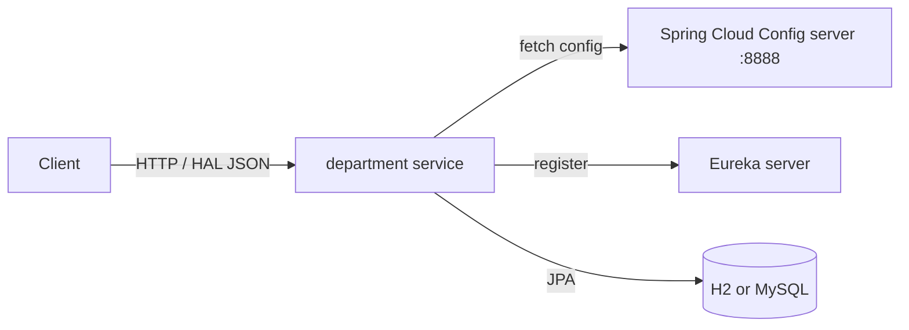

# Gestion of Departments

A Spring Boot microservice (`department`) for managing a university department: students (`etudiant`), teachers (`enseignant`) and administrative staff (`c_administratif`). CRUD REST endpoints are generated automatically by Spring Data REST from JPA repositories. The service is built as a Spring Cloud client: it registers with a Eureka discovery server and reads its configuration from a Spring Cloud Config server.

## Features

- JPA entities for students, teachers and administrative staff
- HAL-formatted CRUD REST API generated by Spring Data REST (paging and sorting included)
- Sample data seeded at startup (three records per entity) by `CommandLineRunner` beans
- Service discovery with Netflix Eureka client (`@EnableDiscoveryClient`)
- Centralised configuration with Spring Cloud Config client (`bootstrap.properties`)
- Spring Boot Actuator (`/actuator`, `/actuator/health`, `/actuator/info`)
- CORS open to all origins on the student endpoints (`@CrossOrigin("*")`)

## Tech stack

| Component | Version |
|-----------|---------|
| Java | 1.8 (`java.version`); builds and runs on newer JDKs as well |
| Spring Boot | 2.3.7.RELEASE |
| Spring Cloud | Hoxton.SR9 (Config client, Netflix Eureka client) |
| Spring Data JPA / Spring Data REST | managed by Spring Boot |
| Databases | H2 (embedded, used when no datasource is configured), MySQL Connector/J (runtime) |
| Build | Maven (wrapper with Maven 3.6.3 included) |

## Architecture



## REST API

Endpoints are exposed by Spring Data REST. Each resource supports `?page=`, `?size=` and `?sort=` on the collection endpoint.

| Method | Path | Description |
|--------|------|-------------|
| `GET` | `/` | Root resource listing all collections |
| `GET` | `/etudiants` | List students |
| `POST` | `/etudiants` | Create a student |
| `GET` / `PUT` / `PATCH` / `DELETE` | `/etudiants/{id}` | Read, replace, update or delete a student |
| `GET` | `/enseignants` | List teachers |
| `POST` | `/enseignants` | Create a teacher |
| `GET` / `PUT` / `PATCH` / `DELETE` | `/enseignants/{id}` | Read, replace, update or delete a teacher |
| `GET` | `/c_administratifs` | List administrative staff |
| `POST` | `/c_administratifs` | Create an administrative staff member |
| `GET` / `PUT` / `PATCH` / `DELETE` | `/c_administratifs/{id}` | Read, replace, update or delete an administrative staff member |
| `GET` | `/profile` | ALPS metadata for the repositories |
| `GET` | `/actuator/health` | Health check |

### Data model

| Entity | Fields |
|--------|--------|
| `etudiant` (student) | `Id_ET` (Long, generated), `name`, `age` (int), `grade` (double) |
| `enseignant` (teacher) | `Id_EN` (Long, generated), `name`, `field`, `dep` |
| `c_administratif` (administrative staff) | `Id_CD` (Long, generated), `name`, `dep`, `post` |

Example:

```bash
curl -X POST http://localhost:8080/etudiants \
  -H "Content-Type: application/json" \
  -d '{"name":"Sara","age":21,"grade":15.5}'
```

## Project structure

```
src/
├── main/
│   ├── java/com/msID/
│   │   ├── SoaCloudDepartmentApplication.java   # entry point + sample data seeding
│   │   ├── DAO/                                 # @RepositoryRestResource JPA repositories
│   │   └── Entity/                              # etudiant, enseignant, c_administratif
│   └── resources/bootstrap.properties           # app name + Config server URI
└── test/java/com/msID/SoaCloudDepartmentApplicationTests.java
```

## Prerequisites

- JDK 8 or newer
- Maven 3.6+ (or the included Maven Wrapper)
- Optional: a Spring Cloud Config server on `http://localhost:8888` and a Eureka server (default `http://localhost:8761/eureka/`). Without them the service still starts: it logs that the config server and Eureka are unreachable and falls back to local defaults.
- Optional: MySQL, if you configure a MySQL datasource. Otherwise an in-memory H2 database is used and data is lost on restart.

## Configuration

`src/main/resources/bootstrap.properties`:

| Key | Value | Purpose |
|-----|-------|---------|
| `spring.application.name` | `department` | Service id in Eureka and the name used to look up configuration on the Config server |
| `spring.cloud.config.uri` | `http://localhost:8888` | Spring Cloud Config server URL |

Other settings (server port, datasource, Eureka URL) are expected to come from the Config server, for example in a `department.properties` file:

```properties
server.port=8082
spring.datasource.url=jdbc:mysql://localhost:3306/department
spring.datasource.username=<user>
spring.datasource.password=<password>
spring.jpa.hibernate.ddl-auto=update
eureka.client.service-url.defaultZone=http://localhost:8761/eureka/
```

## Build, run and test

```bash
# Build
./mvnw -DskipTests package

# Run
./mvnw spring-boot:run
# or
java -jar target/SOA-Cloud-department-0.0.1-SNAPSHOT.jar

# Test (context load test; uses embedded H2, no external services needed)
./mvnw test
```

On Windows use `mvnw.cmd` instead of `./mvnw`.
